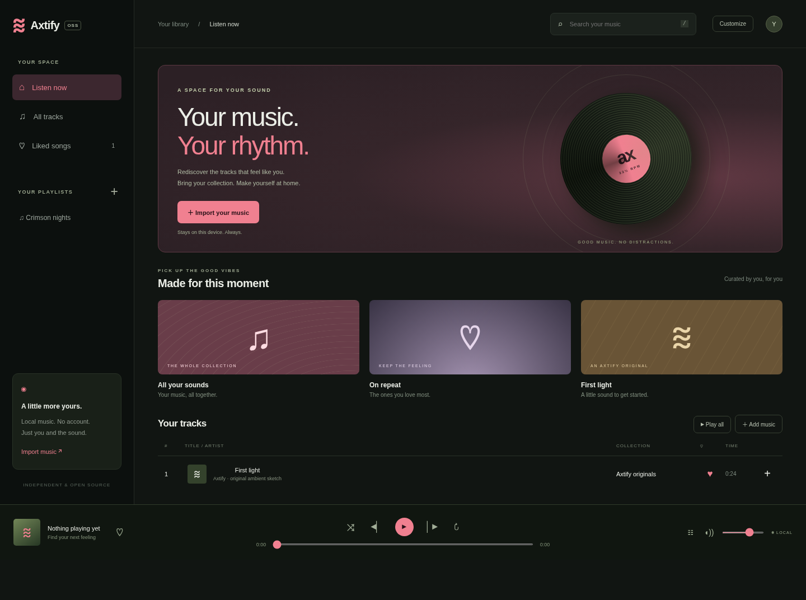

# Axtify

An independent, open-source music player for your own audio collection. Spotify's local-files interface was studied with REA and created with an LLM to inform the project; all app code, visual design, and the included synthesized demo are original.



## Windows desktop app

Download the installer from **[Releases](https://github.com/reddeadplsss/axtify/releases/latest)**. Run `Axtify-Setup-1.1.0-x64.exe`, then open **Axtify** from the Start menu. No Node.js, terminal, or separate browser is required. Requires 64-bit Windows 10 or later.

A portable `.exe` is also available. It does not require installation, but saves library/settings in your Windows user profile, not alongside the executable. Builds are unsigned, so Windows may show an unknown-publisher warning.

The desktop app has its own persistent local library, separate from the browser version. Reimport your audio and Spotify JSON exports when switching. Normal app updates preserve the desktop library; removing its app data removes the library. Keep your original music backed up.

## Run from source

Requires Node.js 22 or later.

```sh
npm ci
npm run desktop
```

To build the Windows installer and portable executable on Windows:

```sh
npm run dist:win
```

Outputs go into `dist/`. The tagged-release workflow builds and tests the packaged app on Windows before publishing the executables and checksums. The first build downloads Electron and packaging tools.

The browser version remains available without installing dependencies: run `node server.mjs`, or double-click `Start-Axtify.cmd` on Windows, then open http://localhost:4173. Keep the server terminal open. Browser storage is scoped to the origin, so keep the same port for the same library.

## Customize

Click **Customize** in the header to change the app name, accent, and background. Defaults: Axtify with light crimson (`#f08090`). Settings persist in the current app/browser profile.

## Import Spotify playlists and track lists

1. Request **Account data** from [Spotify privacy settings](https://www.spotify.com/account/privacy/). Spotify prepares the export; it may not arrive immediately.
2. Extract the downloaded ZIP, then click **Import Spotify** in Axtify.
3. Choose `Playlist*.json` and/or `YourLibrary.json`. Review the playlist and track counts and click **Import track lists**. Multiple files are supported, up to 10 MB and 50,000 entries per file.

This imports names, artists, playlist membership, and Spotify track links when present. It does **not** download or stream Spotify audio. Unsupported entries such as podcasts are skipped. Import processing stays on your device; no developer credentials or Spotify API access are needed. Opening a Spotify link takes you to Spotify.

Tracks match local audio by title and artist (case-insensitive). Import audio named `Artist - Title.mp3` before or after the Spotify import to play matching tracks within their playlists. Unmatched entries are visibly disabled for playback. Reimporting an imported playlist with the same name merges entries; it does not remove older entries. Two exported playlists with the same name merge together.

Spotify documents the export contents in [Understanding your data](https://support.spotify.com/article/understanding-your-data/). JSON layouts may change; the importer supports account playlist exports (`playlists[].items[].track`) and saved-track exports (`tracks[]`).

## Listen

- Import audio files or drag them into the window. `Artist - Title.mp3` filenames populate artist and title; other names use “Local artist.” Tags and embedded artwork are not parsed.
- Play **First light** to hear an original 24-second synthesized ambient sketch.
- Search by title or artist; press `/` to focus search and Space to play/pause outside form fields.
- Like tracks, create named playlists, and use the `+` beside a track to add it to a playlist.
- Play all builds a queue from the current view. Use next, previous, shuffle, repeat, seek, volume, and queue selection.

Audio blobs, likes, and playlists persist in IndexedDB on this browser/device. There is no upload, telemetry, external font, account, or external network dependency. Browser storage limits apply; clearing site data removes the library. Keep original audio files backed up. Audio format support depends on your browser. Desktop and mobile layouts are included.

## Development

```sh
npm test
npm run test:desktop
```

`desktop/` contains the sandboxed Electron shell, restricted local protocol, and external-link policy. No renderer access to Node.js is exposed. Desktop music/settings stay in its persistent app profile. `public/` contains the plain JavaScript app, stylesheet, and HTML. `server.mjs` is a loopback-only static server. Tests cover filtering, queue behavior, filename parsing, generated WAV integrity, and HTTP serving boundaries. Browser checks and their limits are recorded in `docs/VALIDATION.md`.

See [research notes](docs/RESEARCH.md) for evidence, scope, and open questions. This is a standalone local music player, with no Spotify streaming, login, live catalog, or DRM implementation. It is not affiliated with Spotify. No Spotify binaries, source bundles, fonts, artwork, or audio are redistributed.

## License

MIT. Contributions welcome; see [CONTRIBUTING.md](CONTRIBUTING.md).
